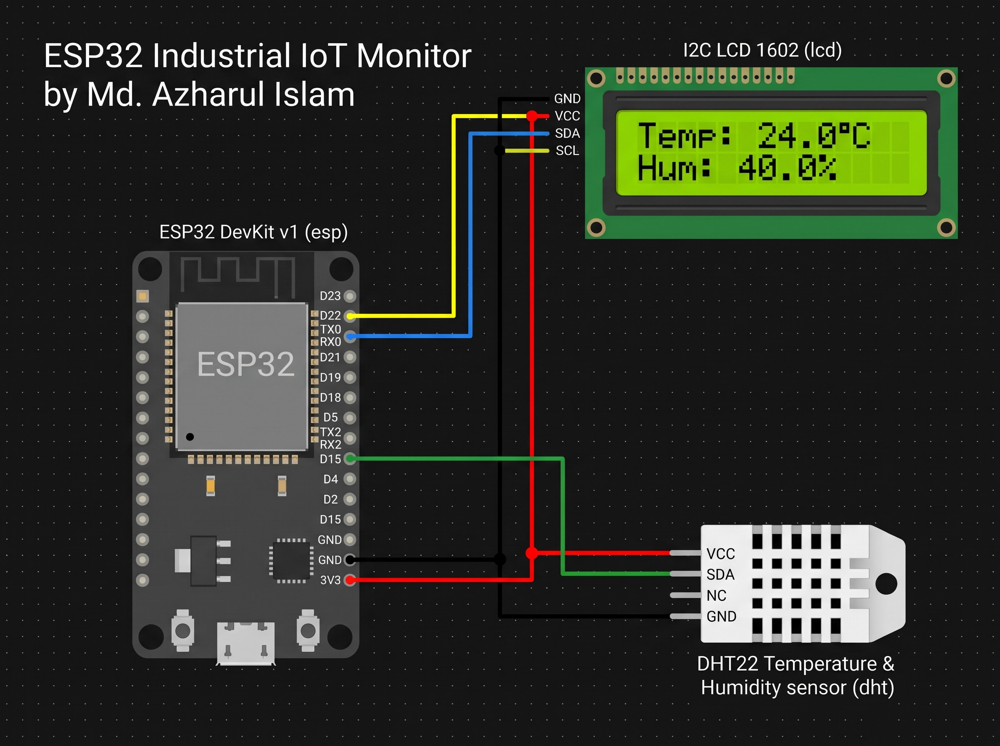

# Industrial IoT Environmental Monitor

**Author:** Md. Azharul Islam  

## 📌 Project Overview
This project is a complete **Industrial Edge Gateway** built on the ESP32. It serves as a dual-interface environmental monitor that reads factory floor temperature and humidity via a DHT22 sensor. 

To ensure continuous operational visibility, the system features a **Local I2C LCD** for immediate physical inspection and an embedded **Asynchronous Web Server** that broadcasts real-time telemetry to a remote browser dashboard. The firmware utilizes strict **non-blocking architecture**, allowing the web server to process incoming HTTP requests instantly without being bottlenecked by hardware sensor polling.

## 🚀 Key Features
*   **Dual-Interface Monitoring:** Syncs live telemetry between a physical 16x2 I2C LCD and a remote HTML/CSS web dashboard.
*   **Non-Blocking Architecture:** Uses `millis()` hardware timers instead of `delay()`, allowing concurrent sensor reading and HTTP client handling without freezing.
*   **RESTful JSON API & AJAX Polling:** The web dashboard uses JavaScript `fetch()` to hit a local `/api/data` endpoint, updating the UI dynamically via JSON payloads without refreshing the page.
*   **Fault Tolerance:** Built-in error handling alerts the user on both the LCD and Serial CLI if the sensor is disconnected or fails to read.
*   **Custom Memory Mapping:** Injects a custom byte-array into the LCD's memory to render a physical degree (`°`) symbol.

## 🔌 Circuit Diagram
The circuit is designed with professional, 90-degree routed parallel buses for clean PCB-style cable management. 



## 🛠️ Hardware & Pin Mapping

| Component | Pin Function | ESP32 DevKit V1 Pin | Wire Color |
| :--- | :--- | :--- | :--- |
| **DHT22 Sensor** | Power (VCC) | `3V3` | Red |
| | Ground (GND) | `GND` | Black |
| | Data (SDA) | `D15` | Green |
| **I2C LCD 1602** | Power (VCC) | `3V3` | Red |
| | Ground (GND) | `GND` | Black |
| | I2C Data (SDA) | `D21` | Blue |
| | I2C Clock (SCL)| `D22` | Yellow |

## 💻 Tech Stack & Libraries
*   **Microcontroller:** ESP32 (Dual-core Xtensa)
*   **Language:** C++ (Arduino Core) / HTML / CSS / JavaScript
*   **Network:** 802.11 b/g/n Wi-Fi (`Wokwi-GUEST` virtual gateway)
*   **Libraries:** 
    *   `<WiFi.h>` & `<WebServer.h>` (Networking & HTTP)
    *   `<Wire.h>` & `<LiquidCrystal_I2C.h>` (I2C Communication)
    *   `<DHT.h>` (Adafruit Unified Sensor)

## ⚙️ Software Architecture
The system operates on a concurrent loop:
1.  **Web Server Listener:** Instantly catches incoming HTTP requests. Serving the root `/` delivers the static HTML/CSS/JS payload, while hitting `/api/data` returns the latest cached sensor variables as a JSON string.
2.  **Hardware Timer Timer:** Every 2,000 milliseconds, the ESP32 queries the DHT22. If the data is valid, it updates the global state variables, refreshes the I2C LCD, and logs the output to the Serial CLI.

## 🚀 How to Run & Simulate (Wokwi)
1.  Create a new ESP32 project in [Wokwi](https://wokwi.com/).
2.  Add the `DHT22` and `I2C LCD 1602` to your workspace.
3.  Paste the provided code into `sketch.ino`.
4.  Paste the routing data into `diagram.json`.
5.  Create a `libraries.txt` file and include:
    ```text
    LiquidCrystal I2C
    DHT sensor library
    Adafruit Unified Sensor
    ```
6.  Click **Play**. 
7.  Watch the LCD display the connection status. Once connected to Wi-Fi, open the **clickable blue network link** in the Wokwi Serial Monitor to view the live dashboard. Click on the DHT22 in the simulator to change the temperature and watch both UIs update instantly.